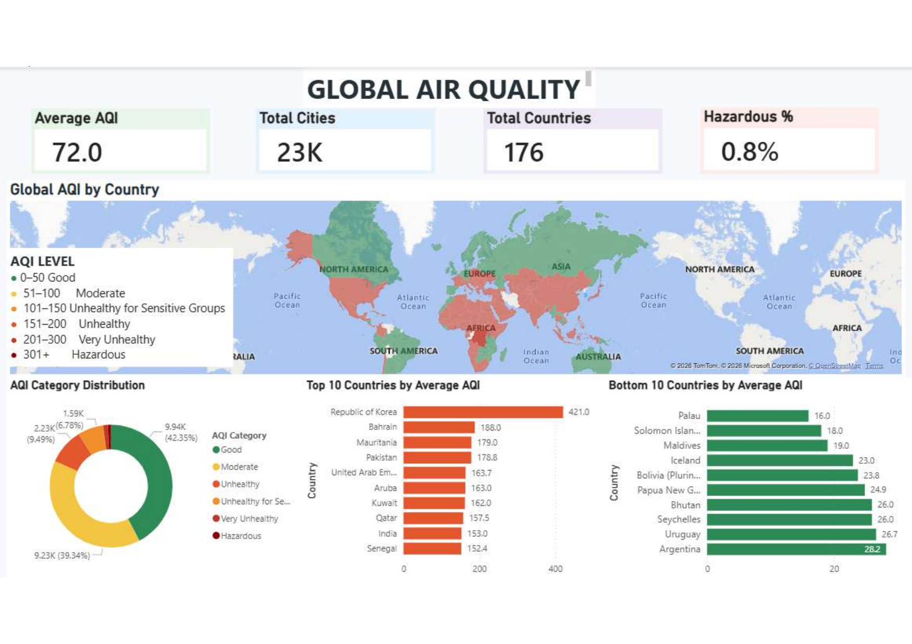
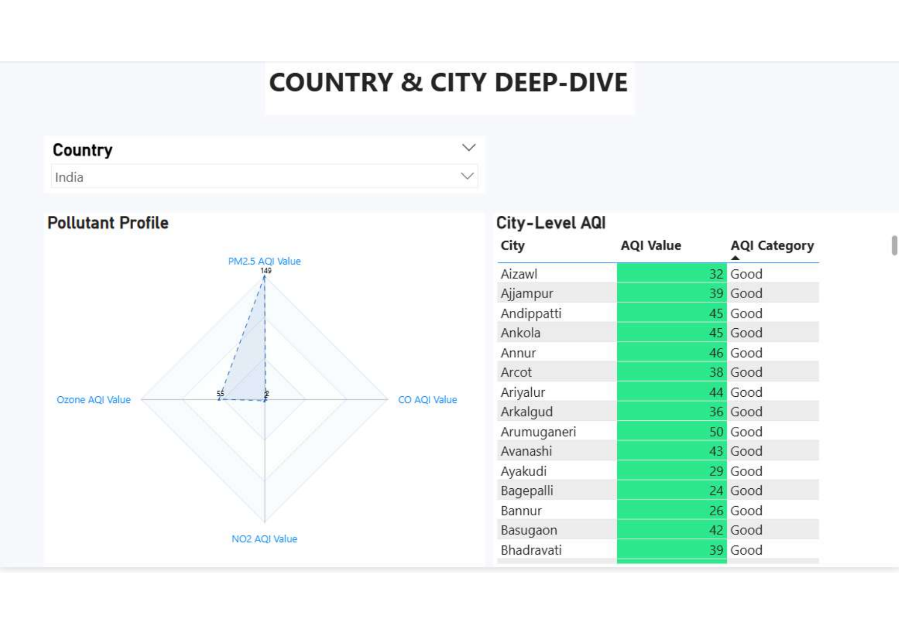
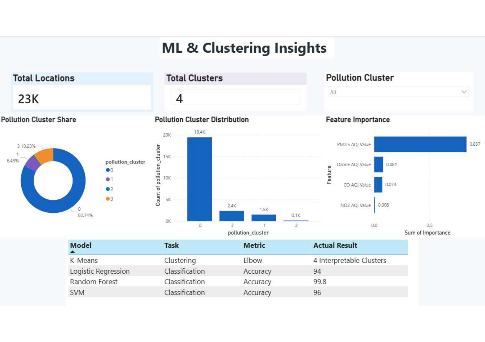
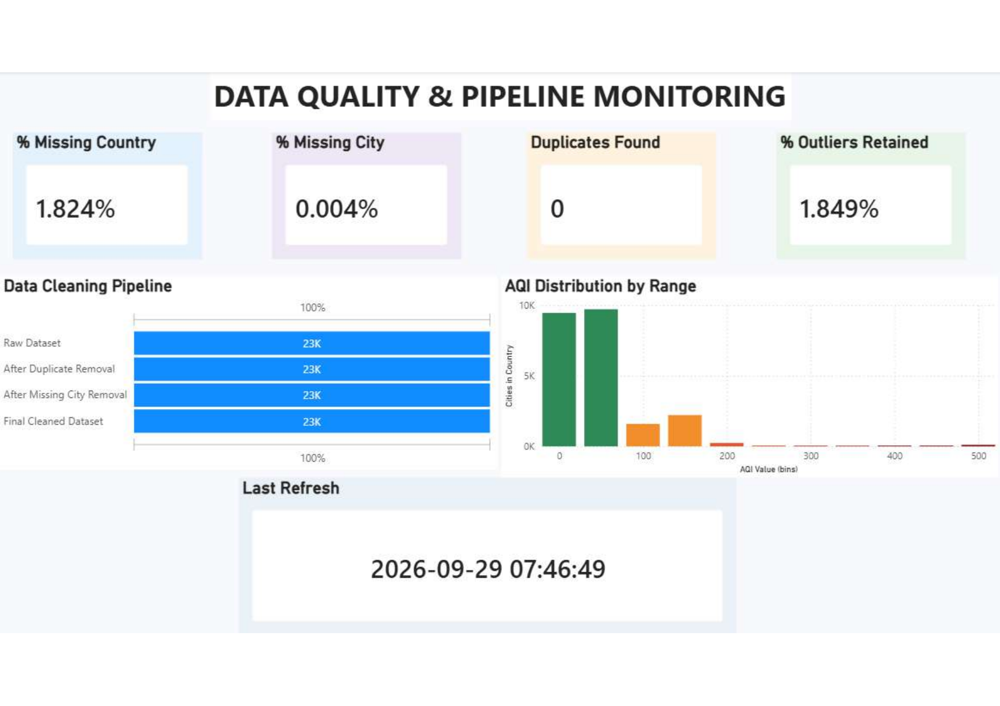
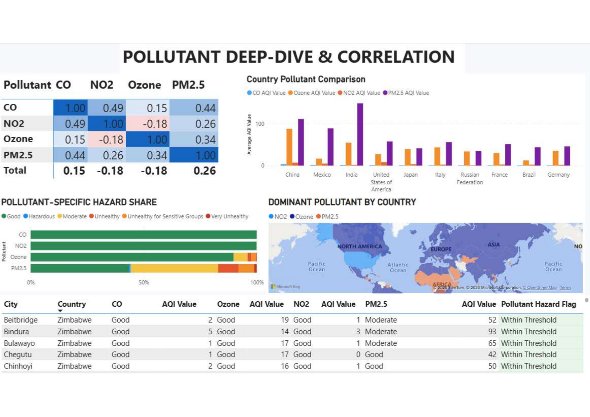

# Global Air Quality Analysis

End-to-end analysis of AQI data across 176 countries and 23K+ cities — from data cleaning through ML clustering/classification to an interactive Power BI dashboard.

## Project Flow
1. **Data Analysis (Jupyter)** — cleaning, missing values, duplicate/outlier detection (IQR method)
2. **SQL** — 20+ queries: window functions (RANK, LAG/LEAD, NTILE), CTEs, self-joins, a stored procedure, and a view
3. **ML Models (Jupyter)** — K-Means & Agglomerative clustering (4 pollution clusters), Logistic Regression, Random Forest, SVM classification
4. **Power BI** — 5-page interactive dashboard

## Tech Stack
Python (pandas, scikit-learn, seaborn) · MySQL · Power BI

## Project Structure
```
global-air-quality-analysis/
├── README.md
├── .gitignore
├── requirements.txt
├── notebooks/
│   ├── 01_data_analysis.ipynb
│   └── 02_ml_models.ipynb
├── sql/
│   └── aqi_queries.sql
├── dashboards/
│   └── screenshots/
│       ├── 01_global_overview.png
│       ├── 02_country_city_deepdive.png
│       ├── 03_ml_clustering_insights.png
│       ├── 04_data_quality_pipeline.png
│       └── 05_pollutant_correlation.png
└── data/
    └── air_quality_clean.csv
```

## Key Results
- Random Forest classifier: **99.8% accuracy** on AQI category prediction
- 4 interpretable pollution clusters via K-Means (elbow method)
- PM2.5 is the dominant driver of AQI variance (feature importance: 0.837)
- Global average AQI: 72.0 across 23K cities in 176 countries; 0.8% hazardous
- Republic of Korea has the highest average AQI (421.0); Palau the lowest (16.0)

## Dashboards

### 1. Global AQI Overview

World map + category distribution + top/bottom 10 countries by AQI.

### 2. Country & City Deep-Dive

Drill-down pollutant radar profile and city-level AQI table, filterable by country.

### 3. ML & Clustering Insights

Cluster distribution, feature importance, and model accuracy comparison (K-Means, Logistic Regression, Random Forest, SVM).

### 4. Data Quality & Pipeline Monitoring

Cleaning pipeline funnel (raw → deduplicated → final) and AQI distribution by range.

### 5. Pollutant Deep-Dive & Correlation

Cross-pollutant correlation matrix and dominant-pollutant map by country.

## How to Run
1. Clone the repo:
   ```bash
   git clone https://github.com/vishnuthakur-05/global-air-quality-analysis.git
   ```
2. Install dependencies:
   ```bash
   pip install -r requirements.txt
   ```
3. Run the notebooks in order: `notebooks/01_data_analysis.ipynb` → `notebooks/02_ml_models.ipynb`
4. Run `sql/aqi_queries.sql` in MySQL (update the CSV path in the `LOAD DATA INFILE` statements first)
5. Open the Power BI `.pbix` file in Power BI Desktop, or view the dashboard screenshots above

## Dataset
Global Air Quality dataset — add your source link here (e.g. Kaggle).

## Author
Vishnu · [LinkedIn](https://linkedin.com/in/vishnuvardhansingh) · [GitHub](https://github.com/vishnuthakur-05)
